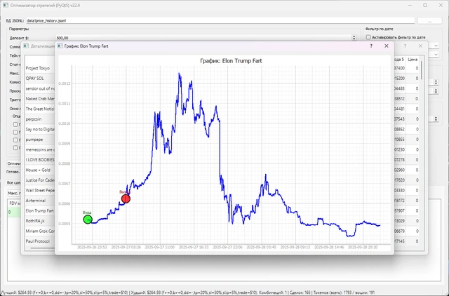

# PumpFun_project

Исследовательский комплекс для работы с продвигаемыми токенами DexScreener. Он обнаруживает токены, собирает рыночные показатели и свечи, сохраняет историю и проверяет торговые правила в симуляторе. Для просмотра и подбора параметров предусмотрены отдельные окна PyQt5.

**Python-портфолио Евгения Толмачева** · Python · PyQt5 · pyqtgraph · DexScreener API · GeckoTerminal API · JSONL



## Возможности

- Обнаруживает токены Solana из списка продвижений DexScreener и фильтрует их по рыночным параметрам.
- Сохраняет метаданные и историю цены, загружает свечи GeckoTerminal с повторными попытками и ограничением частоты запросов.
- Симулирует несколько стратегий с учётом комиссии, проскальзывания и уровней выхода.
- Проверяет правила входа сразу после обнаружения или после просадки; перебирает параметры на истории.
- Показывает сводные результаты, отдельные сделки и график выбранного токена.

## Как устроен проект

### Мониторинг и симулятор

[`boost_main.py`](boost_main.py), [`common_dsx.py`](common_dsx.py)

Главное окно получает токены через Worker, ведёт наблюдение и обновляет состояния симулируемых стратегий.

### История и свечи

[`price_history_app.py`](price_history_app.py), [`candle_engine.py`](candle_engine.py)

Собирают и сохраняют историю, догружают свечи, ограничивают частоту запросов и показывают прогресс.

### Проверка стратегий

[`strategy_optimizer.py`](strategy_optimizer.py)

DataLoader читает историю, Backtester моделирует сделки, а OptimizerWorker перебирает параметры.

### Графики и детали

[`price_history_app.py`](price_history_app.py), [`strategy_optimizer.py`](strategy_optimizer.py)

Окна просмотра позволяют исследовать токен, отдельную сделку и результаты выбранного набора параметров.

## Технологии и их роль

- **PyQt5 и фоновые потоки**: Интерфейсы мониторинга, загрузки данных и управления расчётами.
- **DexScreener и GeckoTerminal API**: Обнаружение токенов, рыночные показатели и исторические свечи.
- **JSON/JSONL**: Сохранение настроек, метаданных, цен и результатов симуляции.
- **pyqtgraph и QPainter**: Графики сделок и собственная отрисовка свечной истории.

## С чего начать просмотр кода

Три основные точки входа - boost_main.py, price_history_app.py и strategy_optimizer.py. Классы Backtester и CandleService показывают вычислительную часть и работу с внешними данными.

## Подготовка и запуск

Создайте отдельное окружение и установите исходные зависимости:

```powershell
python -m venv .venv
.venv\Scripts\Activate.ps1
python -m pip install -r requirements.txt
```

Приложение зависит от доступности DexScreener и других API, указанных в исходниках. Кэш котировок и JSON-состояние не включены. QT_QPA_PLATFORM_PLUGIN_PATH нужен только при ручной настройке Qt; не задавайте ему буквальное значение YOUR_QT_QPA_PLATFORM_PLUGIN_PATH.

Переменные окружения: `QT_QPA_PLATFORM_PLUGIN_PATH`. Образец находится в [.env.example](.env.example). Сам файл .env автоматически не загружается: исходники читают окружение процесса. Значения нужно передать перед запуском, например в PowerShell:

```powershell
$env:QT_QPA_PLATFORM_PLUGIN_PATH = "YOUR_VALUE"
```

После подготовки настроек и необходимых данных основная точка входа:

```powershell
python boost_main.py
```

`requirements.txt` сохранён из проекта. Это снимок окружения, а не гарантия совместимости с новейшей версией Python. Для старых проектов могут потребоваться соответствующая версия Python и настройка системных компонентов.

## Структура

```text
PumpFun_project/
├── docs/
│   └── preview.webp
├── .env.example
├── .gitignore
├── boost_main.py
├── candle_engine.py
├── common_dsx.py
├── price_history_app.py
├── README.md
├── requirements.txt
└── strategy_optimizer.py
```

## Контекст и ограничения

Проект 2025 года разделён на мониторинг, сбор истории и исторические тесты. Общие форматы JSON/JSONL связывают инструменты, а длительные операции выполняются в фоновых потоках. Торговые результаты здесь относятся к моделированию сделок на собранных данных.

Проверены синтаксис Python-файлов и состав публикации. Полный запуск этой версии с внешними сервисами, локальными данными или моделями не выполнялся; команды выше описывают подготовку по исходникам.

## Состав репозитория

Сохранены авторские исходники, их имена и структура, зависимости и компактный скриншот. Рабочие базы, наборы данных, модели и виртуальные окружения исключены. Секреты заменены обозначениями `YOUR_...` / `REDACTED_...`; реальные значения задаются локально. Исходные алгоритмы при оформлении портфолио не перерабатывались.

Автор: [Евгений Толмачев](https://github.com/EvgenyET) · [Портфолио](https://evgeny.tech/)
